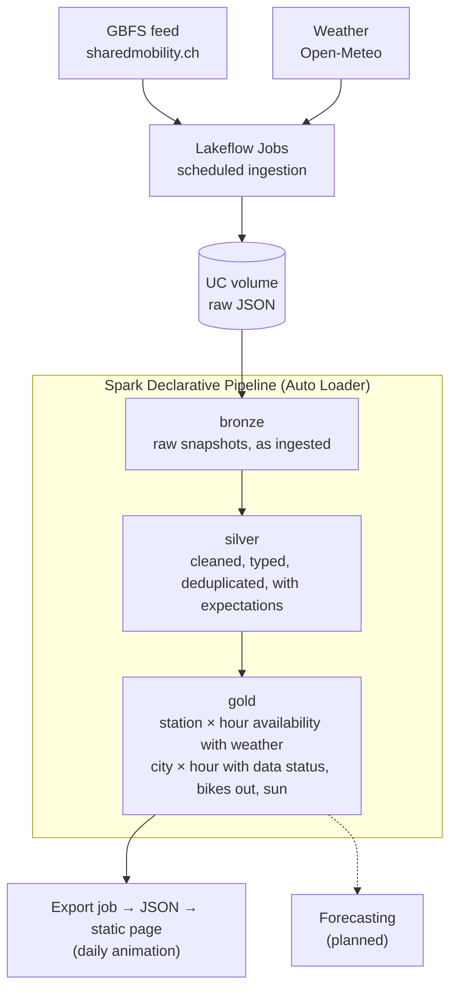

# bikeshare-databricks

Visualizing and forecasting shared-bike availability at Swiss stations from time of day, seasonality and weather, built on Databricks.

This is a learning project for Databricks data engineering: Lakeflow Jobs, Spark Declarative Pipelines, the medallion architecture, Unity Catalog, Git folders and Declarative Automation Bundles (formerly Databricks Asset Bundles). It runs on Databricks Free Edition (serverless).

Built in collaboration with Claude Code as a pair programmer for the animation page and for parts of the code for the pipeline. I authored the architecture, the data modeling decisions, the metric definitions, testing and deployment.

How the data flows from the feeds to the tables, and how the metrics on the animation page are computed: **[docs/DATA_PIPELINE.md](docs/DATA_PIPELINE.md)**.

## Goal

1. **Collect** station-level bike availability snapshots and hourly weather for the station areas (model data: recent past and short-term forecast) on a schedule.
2. **Model** the data in bronze / silver / gold layers, with data-quality expectations.
3. **Visualize** the daily rhythm of each city: bikes docked, bikes out (in use) and the share of stations with activity, hour by hour, with the city's weather, daylight and skyline.
4. **Forecast** available bikes per station from:
   - time of day and day of week
   - seasonality (month, holidays, school vacations)
   - weather (temperature, precipitation, wind)

## Data sources

| Source | What | Format |
|---|---|---|
| [sharedmobility.ch](https://sharedmobility.ch) (Swiss Federal Office of Energy) | Swiss shared-mobility feeds: station information and station status (bikes and docks available) | GBFS (JSON) |
| [Open-Meteo](https://open-meteo.com) (MeteoSwiss ICON-CH1/CH2 models, CC BY 4.0) | Hourly weather (temperature, precipitation, snowfall, wind, clouds, sunshine) for 0.1° grid cells around the bike stations: past 2 days and next 2 days, pulled daily; backfills via the Historical Forecast API | JSON |

## Architecture



## Repository layout

```
bikeshare-databricks/
├─ databricks.yml        # bundle config: targets (dev / prod), variables
├─ resources/            # job and pipeline definitions (YAML)
├─ src/
│  ├─ ingestion/         # notebooks that pull the GBFS feeds and the weather
│  ├─ export/            # notebook that exports gold_city_hour as JSON for the page
│  ├─ pipeline/
│  │  ├─ transformations/  # pipeline code: reference, bronze, silver and gold
│  │  └─ explorations/     # reusable data-check queries, not run by the pipeline
│  └─ forecasting/       # planned
├─ visualizations/
│  └─ daily-animation/   # static page: one city, hour by hour (reads the exported JSON)
├─ docs/
│  └─ DATA_PIPELINE.md   # ingestion, transformations, gold tables, metrics, data quality
└─ README.md
```

## Status

- [x] GBFS ingestion notebook and scheduled Lakeflow Jobs
- [x] Spark Declarative Pipeline: bronze and silver tables with expectations, SCD type 2 station history
- [x] Code in a Git folder (this repo)
- [x] Jobs and pipeline defined as a bundle with `dev` and `prod` targets
- [x] Running in prod on a schedule, with failure alerts
- [x] Weather ingestion (Open-Meteo, daily, with backfill support)
- [x] Gold table: station × hour availability with point-in-time station attributes and weather
- [x] Gold table: city × hour for 13 Swiss cities (docked bikes, data-quality status, estimated bikes out, activity, weather, sun)
- [x] Daily export and a static animation page (`visualizations/daily-animation`)
- [ ] Gold features: calendar (holidays, school vacations) and lag features
- [ ] Forecasting model and evaluation
- [ ] CI: `databricks bundle validate` on every pull request (GitHub Actions)

## Running it

Requires the [Databricks CLI](https://docs.databricks.com/dev-tools/cli/) and access to a Databricks workspace.
Set `workspace.host` in `databricks.yml` to your workspace URL (or remove it and use a CLI profile).

```bash
databricks bundle validate -t dev
databricks bundle deploy   -t dev
databricks bundle run      -t dev <job_key>
```

The `dev` target deploys in development mode: resource names get a `[dev <user>]` prefix and schedules are paused.

## Data and licenses

- Bike data: [sharedmobility.ch](https://sharedmobility.ch), Swiss Federal Office of Energy (SFOE), dataset [Locations and availability of shared mobility services in real time](https://opendata.swiss/en/dataset/standorte-und-verfugbarkeit-von-shared-mobility-angeboten) on opendata.swiss. Open use; source must be provided.
- Weather data by [Open-Meteo.com](https://open-meteo.com/) (MeteoSwiss ICON models), licensed [CC BY 4.0](https://creativecommons.org/licenses/by/4.0/). The values are aggregated and joined to the bike data here.
- This project is not affiliated with or endorsed by SFOE, Open-Meteo or the bike-share operators. Feed values are shown as received; known feed incidents are described in [docs/DATA_PIPELINE.md](docs/DATA_PIPELINE.md#7-data-quality).
