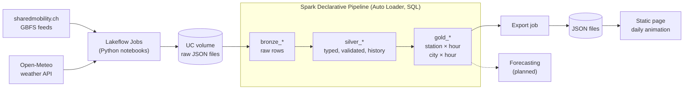

# Data pipeline: from feed to metrics

This page describes how the data gets from the public feeds into the tables and how the metrics on the daily animation page are computed. The SQL files under `src/pipeline/transformations/` are the reference; each one starts with a header comment that states its rules.



All timestamps are stored in UTC. Local time (Europe/Zurich) appears only in columns whose names say so (`*_local`), for display and for local-time features.

## 1. Sources

| Source | Content | Terms |
|---|---|---|
| [sharedmobility.ch](https://sharedmobility.ch), Swiss Federal Office of Energy (SFOE) | Real-time station status and station information for shared mobility in Switzerland, GBFS 2.0 (`https://sharedmobility.ch/gbfs.json`); per-system GBFS 2.3 feeds as a fallback | Open use, commercial use allowed, source must be provided ([dataset on opendata.swiss](https://opendata.swiss/en/dataset/standorte-und-verfugbarkeit-von-shared-mobility-angeboten)) |
| [Open-Meteo](https://open-meteo.com) | Hourly weather from the MeteoSwiss ICON-CH1/CH2 models (`meteoswiss_icon_seamless`) | [CC BY 4.0](https://creativecommons.org/licenses/by/4.0/); values here are aggregated and joined to bike data |

The feed is real-time only: there is no history to download, so every missed pull is a lost snapshot.

## 2. Ingestion (Lakeflow Jobs)

| Job | Schedule (Europe/Zurich) | What it does |
|---|---|---|
| `bikeshare_pull_status` | every 30 min | Downloads `station_status` and writes the JSON file unchanged to `/Volumes/<catalog>/bikeshare/raw/station_status/` |
| `bikeshare_pull_reference` | daily 04:15 | Downloads `station_information`, `providers`, `system_regions` |
| `bikeshare_pull_weather` | daily 05:20 | One Open-Meteo request for all weather grid cells, window from 2 days before to 2 days after the run date; one JSON Lines file per run |
| `bikeshare_refresh` | hourly at :10 | Runs the pipeline `bikeshare_stations` (all tables below) |
| `bikeshare_export_daily_animation` | daily 06:40 | Writes the JSON files for the animation page: the last 7 local days, or the 7 days up to a fixed `end_date` for a reproducible snapshot |

Details worth knowing:

- **Status fallback.** The combined GBFS 2.0 file (about 2.5 MB, all 46 providers) is sometimes cut off by the server mid-download. When three attempts fail, `pull_gbfs.ipynb` downloads the eight bike systems from the per-system GBFS 2.3 feeds instead and writes one file in the same shape as the 2.0 file (same eight station fields, `station_id` as `<system>:<id>`), named `..._v2.json`. The pipeline treats both the same way. Each download attempt has a wall-clock limit, so a slow server cannot block the fallback.
- **Weather grid.** Stations are grouped into 0.1° cells (about 11 × 7.6 km); 110 cells contain at least one bike station. The weather is requested at the centroid of the cell's stations, not at the cell center, so mountain cells are not given summit weather for valley stations.
- **Backfills.** The weather notebook takes a `run_date` parameter, so the Jobs "Run backfill" feature can replay past days (using Open-Meteo's Historical Forecast API when the whole window is in the past).

### Why each source is loaded differently

The two sources behave very differently, and the loading strategy follows from that.

**Bike data: snapshot it or lose it.** The GBFS files are not an archive. They hold the current state only and are overwritten by the publisher all the time, so yesterday's values cannot be fetched again and a backfill is impossible. The only way to build a history is to take snapshots ourselves: every 30 minutes the status file is copied unchanged into the raw volume. The raw files are the project's only record of the past and are never edited; everything downstream can be rebuilt from them.

From there, each table is loaded with the Databricks feature that matches how its data changes:

| Data | How often it changes | What we need | Table type |
|---|---|---|---|
| Raw files → bronze | A new file every 30 min (status) or every day (reference) | Each file read exactly once, as it is | Streaming table with **Auto Loader** |
| Station status | Every snapshot is a new observation | A time series: keep every snapshot | **Streaming table** (append only) |
| Providers, regions | Rarely | The current name and attributes only | **AUTO CDC, SCD type 1** (update in place) |
| Station information | Occasionally (a station moves, is renamed, gets more docks) | The attributes valid *at each hour*, e.g. the capacity on that day | **AUTO CDC, SCD type 2** (keep versions) |

- **Auto Loader** (`read_files` inside a streaming table) keeps track of which files it has already processed. Each pipeline run reads only the files that arrived since the last run, instead of rescanning a folder that grows by about 50 files a day. This is what keeps the hourly refresh cheap as the history grows.
- **Station status as a streaming table.** A snapshot never changes after it is taken, so there is nothing to update: new rows are appended, typed and validated (expectations drop impossible rows). The table is clustered by `snapshot_ts` because nearly every query filters on time.
- **Providers and regions as SCD type 1.** The reference feeds are pulled daily, but their content almost never changes, and only the current value matters (for example a provider's name). `AUTO CDC ... STORED AS SCD TYPE 1` merges each daily file into one row per key instead of appending another full copy. `SEQUENCE BY` the feed's timestamp makes sure an older file can never overwrite newer values.
- **Station information as SCD type 2.** Here history matters: a fill rate for 14 November must use the capacity the station had on 14 November, not today's. SCD type 2 keeps every version with its validity period (`__START_AT`, `__END_AT`), and the gold tables join to the version valid at each hour (a point-in-time join). `TRACK HISTORY ON name, lat, lon, capacity, region_id` limits new versions to changes that matter: the daily file repeats the same ~3,000 stations, and an unchanged station creates no new row. Without this, the table would gain a full copy of every station every day; with it, it grows only when something actually changes. One limitation: a station that disappears from the feed keeps its last version open, because a streaming CDC source contains no deletes.

AUTO CDC (formerly `APPLY CHANGES`) does the bookkeeping that would otherwise need hand-written `MERGE` statements: matching keys, ordering out-of-order records, and opening and closing SCD type 2 versions.

**Weather: an API with history, so backfill is possible.** Unlike the bike feed, Open-Meteo is an API that can be queried for past as well as future hours, so nothing is lost if a pull fails and the history can be filled in later. The ingestion is built around that:

- One request a day covers a five-day window (two days back, two ahead). Consecutive pulls overlap, so a missed day is normally repaired by the next pull without any action.
- For longer gaps or for dates before the project started, the weather job takes a `run_date` parameter. The Lakeflow Jobs **Run backfill** feature starts one run per past date and passes each date in (`{{backfill.iso_datetime}}`); for windows entirely in the past, the notebook switches to Open-Meteo's Historical Forecast API.
- Because pulls overlap and backfills can repeat hours, the same hour arrives several times. Bronze keeps every pull (which is also the history of what was forecast when, needed later to train a model on forecasts rather than on after-the-fact values). Silver keeps one row per grid cell and hour: `AUTO CDC` keyed on (cell, hour) and sequenced by pull time, so the latest pull wins and re-running a backfill is safe (idempotent).

The gold tables are **materialized views**. The pipeline decides on each run whether it can update them incrementally (for example only the station-hours affected by new snapshots) or must recompute them; `gold_city_hour` is recomputed on purpose because its rolling windows and interpolation depend on neighboring hours.

## 3. Bronze: raw rows

Streaming tables fed by Auto Loader (`read_files`), each new file read once.

| Table | Grain | Notes |
|---|---|---|
| `bronze_station_status` | station × file | Exploded `data.stations`, plus feed `last_updated`, `ttl`, stations in file, file name |
| `bronze_station_information`, `bronze_providers`, `bronze_system_regions` | element × file | Same pattern |
| `bronze_weather` | grid cell × hour × file | Hourly arrays exploded by position; explicit schema, so the pipeline also starts on an empty folder. Keeps every pull, i.e. the full history of forecasts |

No type or time-zone conversions happen in bronze.

## 4. Silver: typed, validated, with history

| Table | Grain | Logic |
|---|---|---|
| `silver_station_status` | station × snapshot | `snapshot_ts` = feed `last_updated` (UTC); `last_reported_ts`, `hours_since_reported`, `is_in_service` (installed, renting and returning). Rows with missing keys or negative bike counts are dropped; implausible values are counted but kept (warnings) |
| `silver_station_information` | station × version | AUTO CDC, **SCD type 2**: a new version only when name, position, capacity or region changes |
| `silver_providers`, `silver_system_regions` | provider / region | AUTO CDC, SCD type 1 (latest values) |
| `silver_station_weather_location`, `silver_weather_locations` | station / grid cell | Station-to-cell mapping and the list of cells the weather job asks for |
| `silver_weather` | grid cell × hour | AUTO CDC keyed on (cell, hour), sequenced by pull time: **the latest pull wins**. Past hours hold after-the-fact model values; hours after the latest pull hold forecasts (`is_forecast`) |
| `silver_station_city` | station | Nearest city of `ref_cities` whose radius contains the station (haversine distance) |
| `silver_sun_location_hour` | grid cell × hour | Sun elevation, light phase (day / twilight / night), sunrise, sunset, daylight hours from the NOAA solar formulas |

Hand-maintained reference tables (`reference.sql`):

- `ref_bike_systems`: the eight docked-bike systems in scope (Velospot, nextbike, invia BikeShare, Donkey Republic ×5), with how complete their `capacity` is and a short operator name for display. The feed also carries cars, scooters and mopeds, and its own `vehicle_type` field is not reliable, so this list is the single filter for "bikes".
- `ref_cities`: 13 cities with 45 or more docked-bike stations (center, radius, canton, weather cell, and whether the animation shows the city).
- `ref_data_incidents`: confirmed feed incidents per provider (see section 7).

## 5. Gold tables

### `gold_station_hour`: one row per bike station and UTC hour

Aggregates the snapshots of each hour (normally two, at :00 and :30):

| Column | Meaning |
|---|---|
| `bikes_at_hour_start` | Bikes at the first snapshot of the hour (main candidate target) |
| `bikes_avg`, `bikes_min`, `bikes_max` | Over the hour's snapshots |
| `docks_avg` | Free docks reported (not meaningful for every provider) |
| `n_snapshots` | Snapshots in the hour (1 when a pull was lost) |
| `all_in_service` | Station in service in every snapshot of the hour |

### `gold_station_hour_features`: the station-hour table for modeling

`gold_station_hour` plus:

- **Station attributes valid at that hour** (point-in-time join to the SCD type 2 history): name, position, capacity, region, `fill_rate` = bikes / capacity capped at 1 (empty where capacity is unknown).
- **Weather of the station's grid cell.** Instant values at the hour start (temperature, humidity, cloud cover, wind, weather code) and hourly sums twice: for the hour before (`*_prev_hour`) and during the hour (`*_in_hour`). `weather_is_forecast` marks hours still holding forecast values.
- **City and sun:** `city_id`, distance to the city center, sun elevation, light phase, sunrise and sunset.

Planned: calendar features (public holidays, school vacations) and lagged values for day-ahead forecasting.

### `gold_city_hour`: one row per city and UTC hour

Built on a complete hour spine, so an hour without data still has a row. This table is the semantic layer of the animation: the page only draws what is here. All rules are in the header of `city.sql`.

| Column | Meaning |
|---|---|
| `docked_bikes_raw` | Sum of `bikes_at_hour_start` over the city's stations that reported |
| `data_status` | `ok`, `missing`, `partial`, `glitch_known` or `glitch_suspected` (section 7) |
| `docked_bikes` | Raw value when `ok`; otherwise linear interpolation between the nearest `ok` hours (`is_imputed`) |
| `fleet_baseline_bikes` | Most bikes docked within ±12 hours |
| `bikes_out_est` | `fleet_baseline_bikes − docked_bikes` |
| `bikes_out_peak_recent_7d`, `bikes_out_share_of_peak` | Highest `bikes_out_est` of the last 7 days and the hour's share of it |
| `share_stations_active` | Share of stations whose count changed during the hour (section 6) |
| weather, sun | From the city's weather cell |

## 6. Metrics on the animation page

**Bikes docked.** `docked_bikes`: bikes standing in a dock at the start of the hour, summed over the city's stations, with gaps filled as described above.

**Bikes out (estimate).** The feed has no trips, only how many bikes stand at each station. A bike that is not docked is in use, in the workshop or moved by the operator. The page therefore estimates bikes in use as the drop from the city's recent maximum:

```
bikes_out_est = max(docked_bikes within ±12 h) − docked_bikes
```

The rolling ±12-hour maximum (instead of a fixed fleet size) absorbs slow changes in the fleet, such as bikes going to repair. It uses later hours, so it is a display metric, not a forecasting feature, and the last 12 hours are provisional (`bikes_out_provisional`): their baseline can still rise.

**The bikes on the street.** The scene draws 0 to 9 bikes: `9 × bikes_out_share_of_peak`, i.e. 9 bikes = the city's busiest hour of the last 7 days. Cities are therefore comparable in rhythm, not in size.

**Active stations (%).** Shown in the city panel, the marker label and as a chart option. A station counts as active in an hour when its bike count at the start of the next hour differs from the count at the start of this hour. `share_stations_active` = active stations / stations compared. It counts stations with a pickup or return, not trips: a pickup and a return at the same station within the hour cancel out. It is computed only when this and the next hour are `ok` and at least 90% of the city's stations can be compared; other hours are interpolated, and the latest hour is empty because its next hour does not exist yet.

**Weather and light.** Temperature at the hour start, precipitation during the hour (`snow` when snowfall > 0, `rain` from 0.1 mm), and sun elevation for the day/night cycle. A "forecast" label marks hours whose weather is still a forecast.

**Grey bands.** Hours whose bike values were filled in (`data_status` not `ok`).

## 7. Data quality

**Expectations** in the pipeline drop rows with missing keys or impossible values and count warnings for implausible ones (for example more than 200 bikes, reports older than 30 days, temperatures outside −40 to 45 °C).

**`data_status`** in `gold_city_hour` (first matching rule wins):

| Status | Rule |
|---|---|
| `glitch_known` | The hour falls in a confirmed incident (`ref_data_incidents`) of a provider present in the city |
| `glitch_suspected` | Automatic: the provider's national total is below 80% of its ±12-hour maximum **and** at least 200 bikes below it. The 80% separates feed faults from commuting (normal dips are a few percent in large fleets); the 200-bike floor avoids false alarms in small one-city fleets |
| `missing` | No snapshot for the city in that hour |
| `partial` | Fewer than 90% of the city's stations reported |
| `ok` | None of the above |

**Known incident.** On 18 Nov 2026, from about 08:00 to noon Zurich time, Velospot reported about 37% fewer bikes nationwide while its stations kept reporting. The cause is unknown; the hours are flagged `glitch_known` and interpolated. The data is shown as received from the feed.

**Which cities the animation shows.** Some providers report a station only when something changes, sometimes hours later. Where that dominates, hourly totals hide most movement. A city is left out of the animation (it stays in `gold_city_hour`) when its stations change count in fewer than 10% of station-hours or the median time since a station's last report is above 9 hours. This currently leaves out Basel, Locarno and Sion; the page footer names them with the reason. The check is in `src/pipeline/explorations/city_data_quality.sql`.

**Sanity check before publication (22 Nov 2026, prod, data from 12 Nov 23:00 UTC):**

- 472 of 476 half-hourly snapshots received. The four lost ones are from 16 and 17 Nov: three during a server outage before the fallback existed (including one complete hour, 16 Nov 09:00 to 10:00 Zurich time) and one timed-out download that led to the per-attempt time limit.
- Station tables: no duplicate keys; no violations of min ≤ average ≤ max or negative counts; no missing weather; 2,970 stations every hour of the last 7 days.
- City table: no `glitch_suspected` or `partial` hours; the incident hours flagged as expected.
- The exported JSON matched `gold_city_hour` for all shown cities with no differences.

## 8. Limitations

- **Stock, not trips.** The feed shows bikes per station. Trips, rebalancing by the operator and repairs all look the same: a change in a count. "Bikes out" and "activity" are estimates built on that.
- **Late reports.** Velospot and Donkey stations report on events, often hours late (median a few hours). Activity then appears in the hour the report arrives. Part of the night-time activity in some cities is this effect.
- **Capacity.** Not reported for `nextbike_ch` and only partly for `nextbike_ms`; `fill_rate` is empty there. Some stations report more bikes than their capacity; the fill rate is capped at 1.
- **Model weather.** Weather values come from a weather model on a 0.1° grid, not from station measurements.
- **Short history.** Collection started on 12 Nov 2026. Weekly and seasonal patterns, holidays and weather effects need weeks to months of data before they can be estimated reliably.
